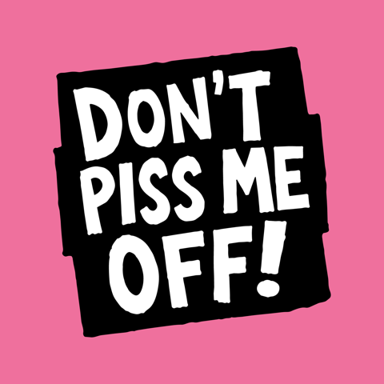

# Don't Piss Me Off!

Source of [donotpissmeoff.com](https://donotpissmeoff.com), the portfolio of Diego Pignattini, web developer in Rome.

It is a static site: three HTML pages, one stylesheet, two small scripts. No framework, no build step, no dependencies, no third-party requests. The whole home page, pigeon included, weighs less than most cookie banners.



## What's inside

```
index.html          home
privacy.html        privacy notice (served as /privacy)
404.html            not-found page, served for every missing URL
css/style.css       all the styles: tokens, components, sections, responsive rules
js/main.js          page interactions: one state object, one render()
js/mo.js            Mo the pigeon's animation (SVG clipping over the PNG artwork)
assets/             artwork, screenshots, self-hosted fonts
deploy.sh           publishes the public files to the server (rsync)
deploy/Caddyfile    web server config: HTTPS, headers, caching, clean URLs, 404
deploy/contact/     contact form backend: a small Python relay and its systemd unit
docs/               notes on Mo's artwork and animation
```

## How it's built

**HTML.** Semantic and class-based, no inline styles or scripts. Works without JavaScript: the navigation, the translator's phrase list and every section stay readable; scripts only add the interactive parts.

**CSS.** One file, read top to bottom: fonts and tokens, base, layout helpers, shared components, then one block per section. Four colours and two typefaces, all defined once as custom properties. Desktop is the baseline and two media queries (1023px, 767px) adapt it. Motion stops under `prefers-reduced-motion`.

**JavaScript.** `js/main.js` keeps one `state` object and one `render()` function. The markup declares what it needs:

| Attribute | Meaning |
| --- | --- |
| `data-action` (+ `data-value`) | a button that changes the state |
| `data-if="flag"` | shown only while the flag is true |
| `data-text="slot"` | text filled in from the state |
| `aria-pressed` | the selected button of a group, styled from the attribute |

Adding an interaction means adding a field to `state`, an entry in `actions` and an attribute in the HTML.

**Mo.** The pigeon is raster line art. `js/mo.js` wraps each large illustration in an inline SVG, cuts out the part that moves (head or wing) with a clip path and lets CSS keyframes rotate it; eyelids and steam are vectors drawn on top. Animations pause when off-screen. Details in [docs/mo-animation.md](docs/mo-animation.md).

**Contact form.** The browser posts JSON to `/api/contact`. Caddy proxies it to a relay on localhost ([deploy/contact/contact_relay.py](deploy/contact/contact_relay.py), Python standard library only) that validates the input, drops bots (honeypot field, minimum fill time), rate-limits per IP, writes the message to a spool on disk and forwards it to a signed webhook. A message is confirmed to the visitor only once it is on disk, and stays in the spool until the webhook accepts it, so nothing is lost if the receiving side is down. The service runs as its own user under a locked-down systemd unit; secrets live on the server, never in this repository.

**Server.** [Caddy](https://caddyserver.com) with automatic HTTPS, HSTS, a Content-Security-Policy that allows this origin only, and access logs with truncated IP addresses. No cookies and no analytics: the [privacy notice](https://donotpissmeoff.com/privacy) is short because there is little to disclose.

## Run it locally

```sh
npx serve .
```

Or any other static server. The contact form needs the relay, so locally it answers with an error message (which is also a way to see the error state).

## Deploy

```sh
./deploy.sh                    # site files -> web root
./deploy/contact/install.sh    # contact relay (only when it changes)
```

Both expect an SSH host alias (`DEPLOY_HOST`, default `vex-vps`). CSS and JS are cached for an hour and not fingerprinted: bump the `?v=N` in the HTML files when they change.

## Rights

The code is here to be read, and you're welcome to learn from it. The "Don't Piss Me Off!" name and logo, Mo the pigeon and all his artwork, the copy and the project screenshots are © Diego Pignattini and not free to reuse. The fonts (Anton, Work Sans) are under the SIL Open Font License; their licence texts are in [assets/fonts](assets/fonts).

© 2026 Diego Pignattini
